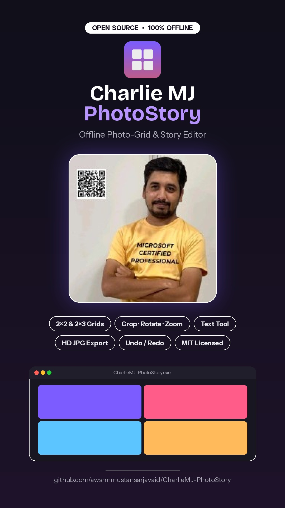

<div align="center">

# CharlieMJ PhotoStory **v2**

**Offline photo-story studio for Instagram Stories, Reels & Posts.**
Photo layouts · text · emoji · timestamps · filters · layers · templates · batch export — no account, no upload, no backend.



## Download

<p align="center">
  <a href="https://github.com/awsrmmustansarjavaid/CharlieMJ-PhotoStory/releases/latest">
    
  </a>
  &nbsp;
  <a href="https://awsrmmustansarjavaid.github.io/CharlieMJ-PhotoStory/">
    
  </a>
</p>

</div>

## Quick start

- **Web / any browser:** open [`web/index.html`](web/index.html) (or the root `index.html`, which redirects there). No build step, works from `file://`.
- **Windows portable app:** build with the included GitHub Action (*Actions → build-windows-exe → Run workflow*) or follow [`desktop-tauri/BUILD-WINDOWS.md`](desktop-tauri/BUILD-WINDOWS.md). The desktop build adds a native folder picker, "Open location", and `settings.json` stored next to the `.exe`.

## What's new in v2

| Area | Features |
|---|---|
| **Layouts** | 1×1, 2×1, 3×1, 1×2, 1×3, 2×2, 3×2, 2×3, 3×3 and custom grids (rows × columns). Adjustable gap, margin, rounded corners, outline, frame colour and per-row/column panel sizes. |
| **Photos** | Independent zoom / pan / rotate / flip / fit / fill per photo, smart auto-placement that keeps the busiest (most important) area in frame, drag-and-drop, ordering by filename / file date / manual. |
| **Enhance** | Brightness, contrast, saturation, warmth, sharpness, grayscale, blur + 8 preset filters. |
| **Text & stamps** | Multiple text boxes, fonts (and your own font files), size, colour, alignment, outline, shadow, background box. Date/time stamp with custom formats, live clock or fixed time, location and caption. |
| **Emoji & logos** | Movable/resizable emoji (🇵🇰 🇹🇷 are drawn as vectors so they work on Windows), logo / signature image, username watermark. |
| **Backgrounds** | Solid, gradient, blurred photo, custom image, transparent. Colour-palette extraction from photos. |
| **Layers** | Select, reorder, lock, hide, duplicate, delete — for photos, text, emoji, stamps, logos. |
| **Designs** | Instagram Story, Reel, Post (4:5), Square. Safe-area overlay for Story/Reel UI zones. |
| **Export** | Rendered natively at **1080 × 1920** (or 1440 × 2560), never up-scaled. JPG (quality 50–100), PNG, WebP. Batch export with progress & success/failure counts. Folder picker + filename + status. |
| **Projects** | Save / reopen editable `.cmjstory.json` projects, templates (9 built-in + your own), "duplicate design & clear photos", crash recovery. |
| **Workspace** | Dark Creative Studio (violet accent) + light theme, UI scale, compact mode, keyboard shortcuts, undo/redo (100 steps), toast notifications, status bar. |

## Architecture (modular)

```
web/
  index.html            shell: top bar · left tools · canvas · right properties
  css/style.css         Dark Creative Studio theme (variables → light theme)
  js/core.js            state model, asset library, undo/redo
  js/layouts.js         Layout Engine  (grids → rectangles, smart placement)
  js/filters.js         photo enhancement + presets
  js/stamp.js           date/time formatting
  js/render.js          Rendering Engine (preview + any-resolution export)
  js/editor.js          Editing Engine (hit-test, drag, zoom, layers, shortcuts)
  js/notify.js          Notification Service (toasts, status bar)
  js/settings.js        preferences, IndexedDB, crash recovery
  js/services.js        Export · Project · Template services, palette
  js/ui.js              panels & dialogs
  js/app.js             bootstrap
desktop-tauri/          Windows wrapper (Tauri 2) + native helpers in main.rs
legacy/                 the v1 app and binaries, kept for reference
docs/                   documentation
```

See [`docs/`](docs/README.md) for the usage guide, shortcuts, architecture diagram and known limitations.

## Privacy

Photos and projects never leave your PC. No account, analytics or network calls. Crash-recovery data lives in your browser's/app's local storage.

## License

MIT — see [LICENSE](LICENSE).
